<p align="center">
  <picture>
    <source media="(prefers-color-scheme: light)" srcset=".github/assets/logo-light.svg">
    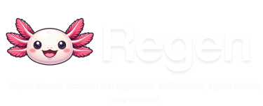
  </picture>
</p>

<p align="center">
  Open-source on-call and incident management. Alerts, incidents, schedules and AI postmortems in one place.<br>
  Part of the <a href="https://fluidify.ai">FluidifyAI</a> open-source suite.
</p>

<p align="center">
  <a href="https://github.com/FluidifyAI/Regen/actions/workflows/ci.yml"></a>
  <a href="https://github.com/FluidifyAI/Regen/releases"></a>
  <a href="https://discord.gg/b6PSdhzDa"></a>
  <a href="LICENSE"></a>
  <a href="https://github.com/FluidifyAI/Regen/pkgs/container/regen"></a>
  <a href="https://goreportcard.com/report/github.com/FluidifyAI/Regen/backend"></a>
</p>

<p align="center">
  <a href="https://regen.fluidify.ai"></a>
  <a href="#quick-start"></a>
</p>

<p align="center">
  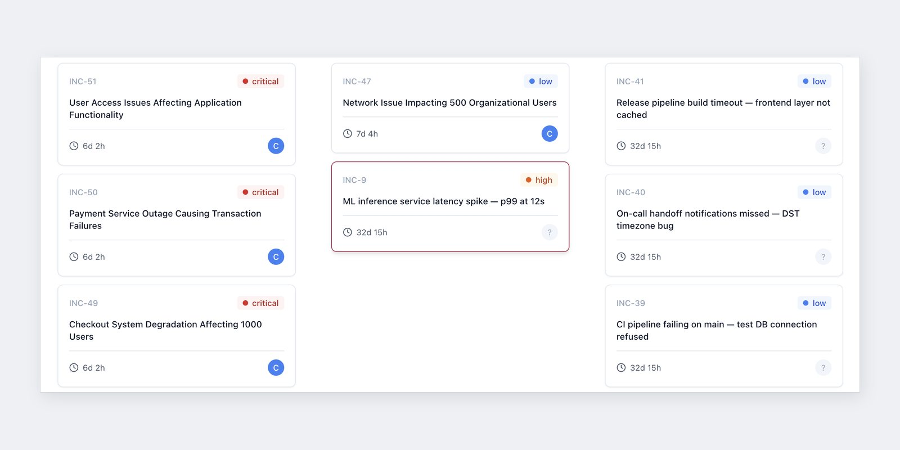
</p>

## Why Regen

- **No per-seat pricing.** Self-host free forever, or run on Regen Cloud for $100/month flat.
- **One tool, not three.** Alerts, incidents and on-call share one timeline.
- **Your AI, your data.** Bring your own OpenAI, Anthropic or Ollama key.
- **No limits.** Unlimited incidents, schedules, AI postmortems and handoff digests.

## Features

<table>
  <tr>
    <td width="50%" valign="top">
      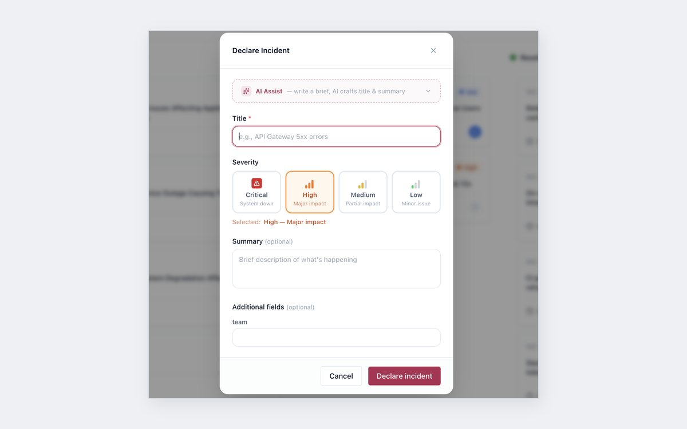<br>
      <b>Incidents with an immutable timeline</b><br>
      Alerts open incidents automatically, or declare one by hand with AI writing the title and summary.
    </td>
    <td width="50%" valign="top">
      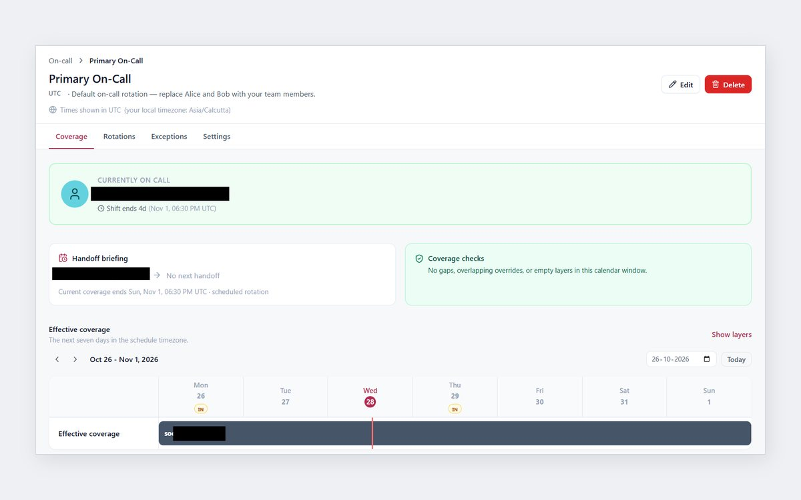<br>
      <b>On-call schedules</b><br>
      Layered rotations, overrides, holidays and leave, with who is on call shown at a glance.
    </td>
  </tr>
  <tr>
    <td width="50%" valign="top">
      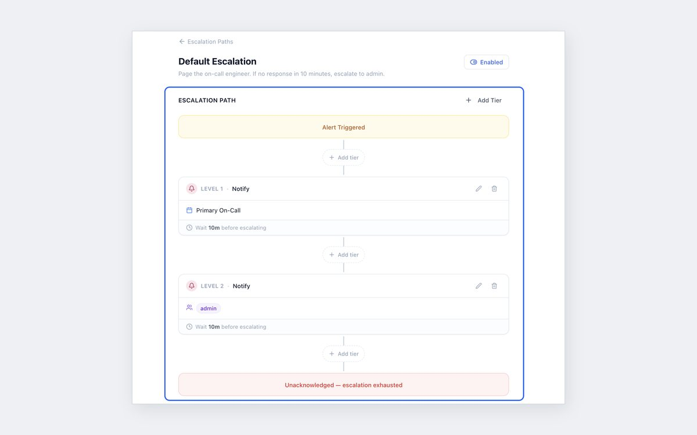<br>
      <b>Escalation paths</b><br>
      Multi-step escalation with timeouts, so an unacknowledged page always reaches the next person.
    </td>
    <td width="50%" valign="top">
      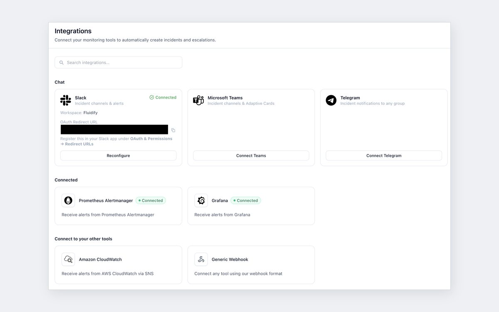<br>
      <b>Alerts from your existing tools</b><br>
      Prometheus Alertmanager, Grafana, CloudWatch and a generic webhook, plus Slack, Teams and Telegram.
    </td>
  </tr>
  <tr>
    <td width="50%" valign="top">
      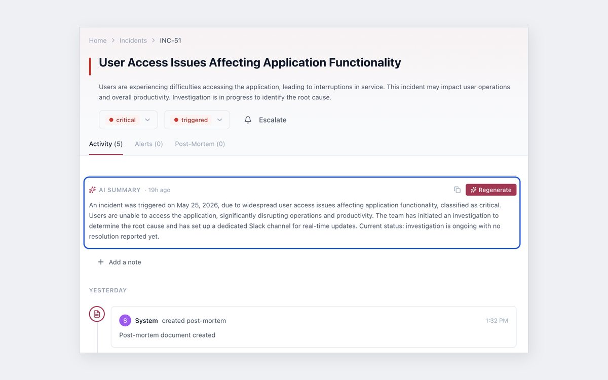<br>
      <b>AI summaries</b><br>
      One-click incident summaries and handoff digests, synced to Slack and Teams.
    </td>
    <td width="50%" valign="top">
      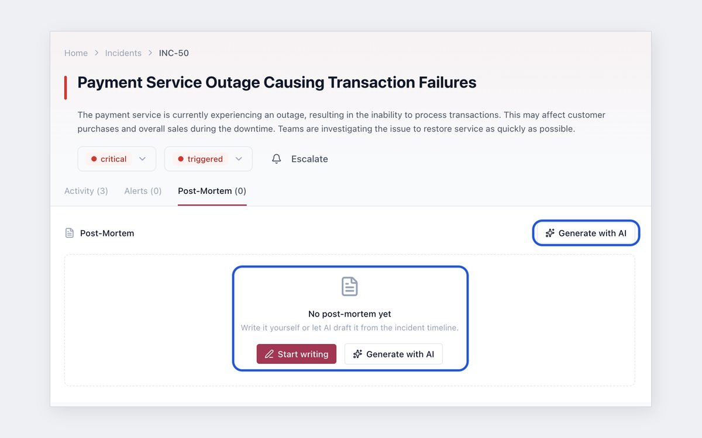<br>
      <b>AI postmortems</b><br>
      Editable postmortem drafts built from the incident timeline, with your own templates.
    </td>
  </tr>
  <tr>
    <td width="50%" valign="top">
      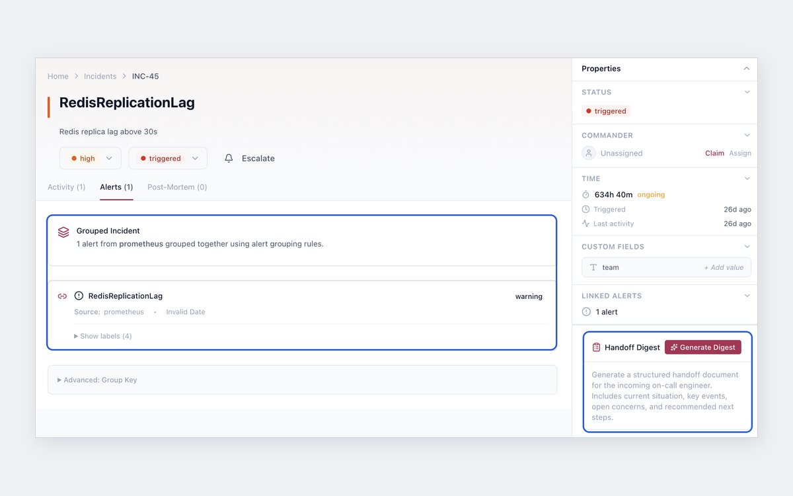<br>
      <b>Similar past incidents</b><br>
      New incidents are matched against history so responders see what worked last time.
    </td>
    <td width="50%" valign="top">
      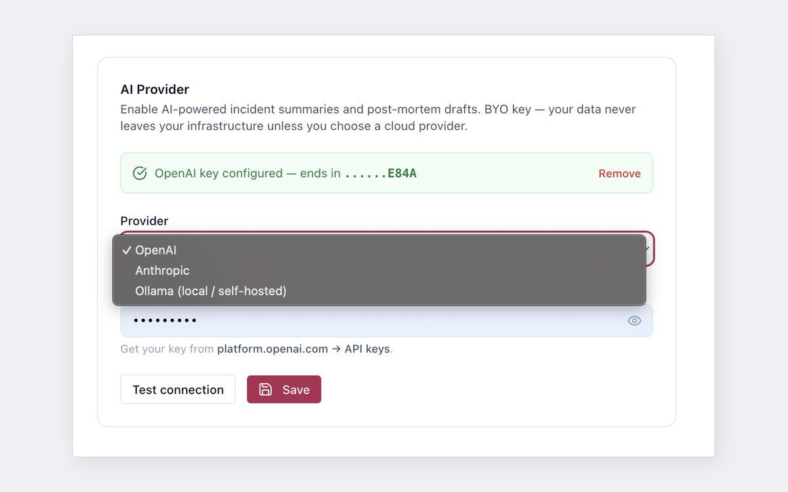<br>
      <b>Bring your own AI key</b><br>
      OpenAI, Anthropic, or Ollama running on your own hardware. Regen works fully without AI too.
    </td>
  </tr>
  <tr>
    <td width="50%" valign="top">
      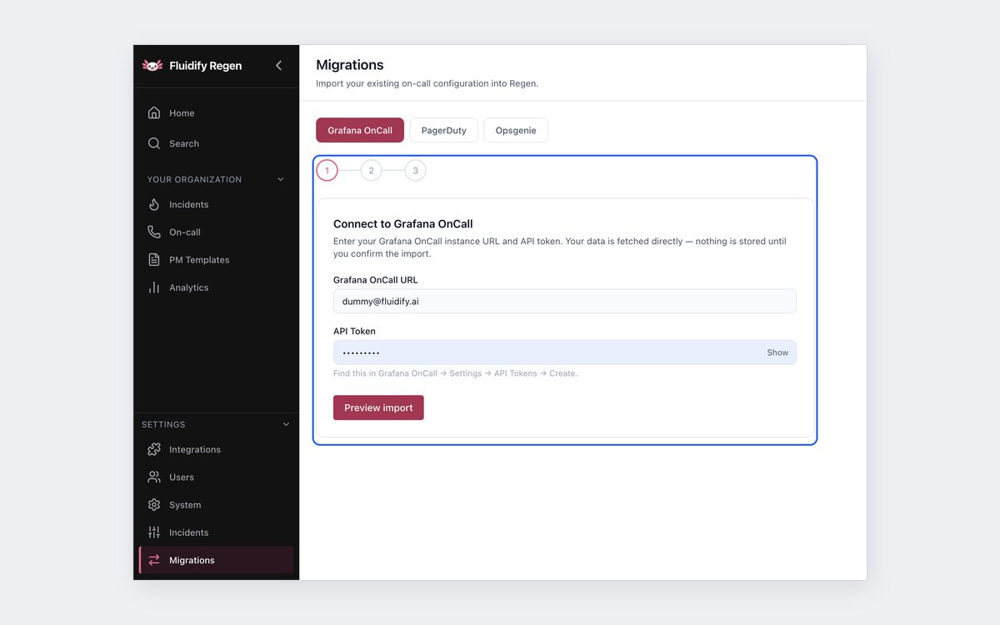<br>
      <b>1-click import</b><br>
      Bring schedules and escalation policies over from <a href="docs/migrations/pagerduty.md">PagerDuty</a>, <a href="docs/migrations/opsgenie.md">Opsgenie</a> or <a href="docs/migrations/grafana-oncall.md">Grafana OnCall</a>.
    </td>
    <td width="50%" valign="top">
      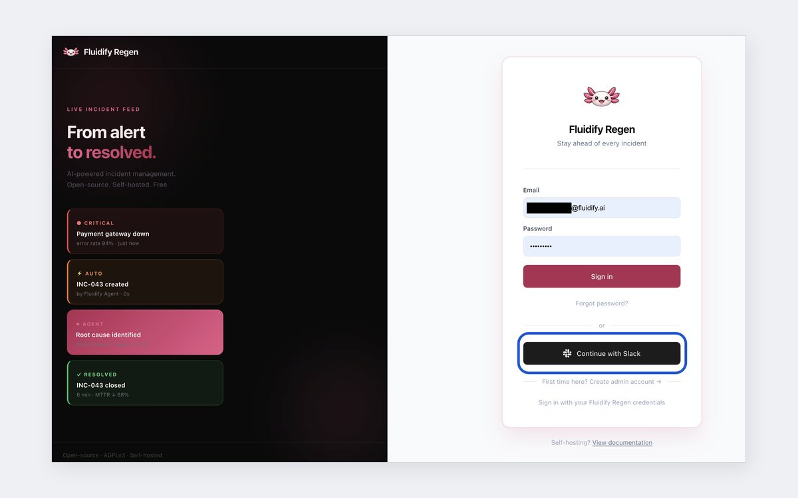<br>
      <b>SSO and SAML, free</b><br>
      Okta, Azure AD, Google Workspace or any SAML 2.0 provider.
    </td>
  </tr>
</table>

**Also included:** Slack and Microsoft Teams channels with bot commands and timeline sync · Telegram · Docker Compose · Kubernetes Helm chart · PostgreSQL HA · Redis Sentinel

<details>
<summary><b>All integrations</b></summary>

| Category | Tools |
|---|---|
| **Alert ingestion** | Prometheus Alertmanager · Grafana · AWS CloudWatch · Generic webhook |
| **Chat** | Slack · Microsoft Teams · Telegram |
| **AI** | OpenAI · Anthropic · Ollama (BYO key, local or cloud) |
| **Auth** | SAML 2.0: Okta · Azure AD · Google Workspace · any compliant IdP |
| **Migration** | Grafana OnCall · PagerDuty · Opsgenie |
| **Deploy** | Docker Compose · Kubernetes Helm · bare metal |

</details>

## Two ways to run Regen

| | **Regen Cloud** | **Self-hosted (this repo)** |
|---|---|---|
| Get started | [Sign up at regen.fluidify.ai](https://regen.fluidify.ai) | [Quick start](#quick-start) below |
| Price | 30-day free trial, then $100/month flat. No per-seat pricing | Free forever (AGPLv3) |
| Hosting, upgrades, backups, HA | Managed by us | You run it |
| Paging by SMS, voice call and email | Included (with monthly allowances) | Bring your own providers |
| OnCall mobile app (iOS/Android) push | Included | Not included |
| Support | SLA based | Community ([Discord](https://discord.gg/b6PSdhzDa)) |

Same core product either way. See [pricing](https://fluidify.ai/pricing) for Cloud allowances.

## Regen vs PagerDuty, incident.io and Grafana OnCall

| | Regen | PagerDuty | incident.io | Grafana OnCall |
|---|---|---|---|---|
| Price | Free (self-hosted) · $100/mo flat (Cloud) | $21–50/user/mo | $30+/user/mo | Archived |
| Per-seat pricing | ❌ None | 💰 Yes | 💰 Yes | n/a |
| Managed cloud option | ✅ | ✅ | ✅ | ❌ (archived) |
| Self-hosted | ✅ | ❌ | ❌ | ✅ (archived) |
| Open source | AGPLv3 | ❌ | ❌ | Apache 2.0 |
| SSO | ✅ Free | 💰 Paid | 💰 Paid | ✅ Free |
| BYO AI | ✅ | ❌ | ❌ | ❌ |
| Agent-native | ✅ | ❌ | ❌ | ❌ |
| Alert + incident + on-call in one | ✅ | 💰💰💰 Paid | 💰💰💰 Paid | 💰💰💰 Paid |
| 1-click imports | ✅ | ❌ | ❌ | ❌ |

## Quick start

```bash
git clone https://github.com/FluidifyAI/Regen.git
cd Regen
cp .env.example .env   # add your Slack token, AI key, etc.
make start
```

Open **http://localhost:8080** and create your admin account on first load.

Guides: [Installation](docs/getting-started/installation.md) · [Docker Compose](docs/self-hosting/docker-compose.md) · [Kubernetes / Helm](docs/self-hosting/kubernetes.md) · [Environment variables](docs/self-hosting/environment-variables.md) · [Connecting Slack](docs/getting-started/connecting-slack.md)

> Rather not run it yourself? [Start on Regen Cloud](https://regen.fluidify.ai): managed hosting, backups and upgrades, ready in minutes.

<details>
<summary><b>Send a test alert</b></summary>

```bash
curl -X POST http://localhost:8080/api/v1/webhooks/prometheus \
  -H "Content-Type: application/json" \
  -d '{
    "receiver": "fluidify-regen",
    "status": "firing",
    "alerts": [{
      "status": "firing",
      "labels": {"alertname": "TestAlert", "severity": "critical"},
      "annotations": {"summary": "Test alert from curl"},
      "startsAt": "2024-01-01T00:00:00Z"
    }]
  }'
```

An incident is created automatically. If Slack is configured, a dedicated channel appears within seconds.

Regen uses Slack's HTTP Events API (signed `POST` to `/api/v1/slack/{events,interactions,commands}`), not Socket Mode, so local dev needs a public tunnel such as ngrok. Full setup, including the three Request URLs and troubleshooting, is in [docs/getting-started/connecting-slack.md](docs/getting-started/connecting-slack.md).

</details>

<details>
<summary><b>Built for production: benchmarks and high availability</b></summary>

Benchmark results (HA stack · Apple M2 / Colima · 2026-03-31):

| Scenario | Result |
|---|---|
| Webhook ingestion p99 | **< 10 ms** (target: < 200 ms) |
| Webhook sustained p50 / p95 | **1.55 ms / 2.82 ms** |
| API reads p95 (list / detail) | **4.42 ms / 2.83 ms** |
| Peak throughput (burst test) | **3,917 RPS, 0 × 5xx** |
| PostgreSQL failover RTO | **11 s** (Patroni + HAProxy, target: < 60 s) |
| Redis failover RTO | **5 s** (Sentinel 3-node quorum) |
| In-flight requests lost on rolling deploy | **0** |

These were captured on a single-machine local HA stack; production numbers will be higher. Reproduce them with `make load-test` and `make chaos-db`. Full methodology in [docs/RELIABILITY.md](docs/RELIABILITY.md).

How it stays up:

- **Zero-downtime deploys:** rolling restarts drain in-flight requests before pod shutdown (SIGTERM, 30 s drain, exit)
- **PostgreSQL HA:** Patroni manages automatic primary election; HAProxy re-routes to the new primary within one health-check interval (3 s). No app restart, no config change.
- **Redis Sentinel:** a 3-node quorum detects primary loss; workers reconnect to the new master automatically
- **Kubernetes-native:** HPA, health-gated rolling deploys, resource limits out of the box
- **Webhook flood protection:** the rate limiter returns 429 before the DB sees load spikes; validated at 3,917 RPS with zero OOM events
- **Full observability:** `/metrics` (Prometheus) plus a pre-built Grafana dashboard in `deploy/grafana/`

</details>

<details>
<summary><b>Security</b></summary>

- **Authentication:** bcrypt (cost 12), timing-safe comparison, 5-attempt account lockout, HTTP-only SameSite=Strict session cookies
- **No SQL injection surface:** all database access uses GORM parameterized queries, with no raw string interpolation
- **Webhook verification:** Slack (HMAC-SHA256 + replay protection), Teams (RSA/OIDC), CloudWatch (RSA + SSRF-safe cert validation)
- **Rate limiting:** a Redis Lua script enforcing three tiers: 10/min on auth endpoints, 120/min unauthenticated, 600/min authenticated
- **Security headers:** CSP, HSTS (2 years), X-Frame-Options, X-Content-Type-Options, Permissions-Policy on every response
- **Container hardening:** non-root UID 1001, read-only filesystem, all Linux capabilities dropped
- **CORS:** explicit allowlist via `CORS_ALLOWED_ORIGINS`; dev-only fallback to localhost
- **Frontend:** no `dangerouslySetInnerHTML`, no secrets in the bundle, session token never accessible to JavaScript

Before going live, work through the **[Production Security Checklist](SECURITY.md#11-production-security-checklist)**: TLS, PostgreSQL password, Redis auth and CORS origins. Full security architecture: [SECURITY.md](SECURITY.md).

</details>

## Contributing

We love contributions big and small.

```bash
# Start backend + dependencies
docker-compose up -d db redis

# Run backend with hot reload
cd backend && go run ./cmd/regen/... serve

# Run frontend with hot reload
cd frontend && npm install && npm run dev
```

- Read the setup and workflow in [CONTRIBUTING.md](CONTRIBUTING.md)
- Discover all developer commands with `make help`
- Have a big idea? [Let's discuss it first](https://github.com/FluidifyAI/Regen/discussions)

If Regen is useful to you, **star this repo** so others can find it, and [open an issue](https://github.com/FluidifyAI/Regen/issues/new) with anything you'd like to see.

## License

[AGPLv3](LICENSE): free forever, including SSO.

<p align="center">Built by <a href="https://fluidify.ai">FluidifyAI</a> · your incident data belongs to you</p>
